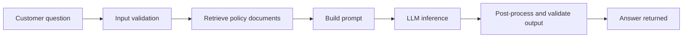
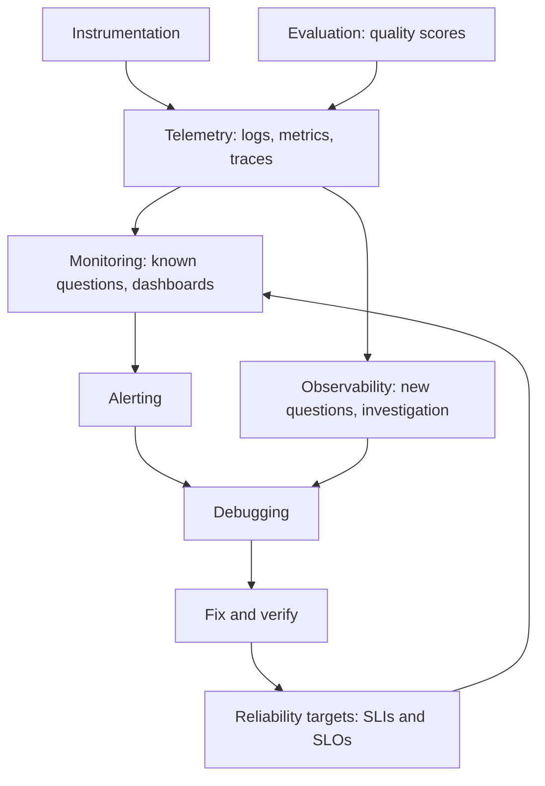
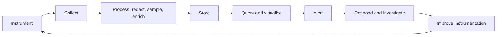
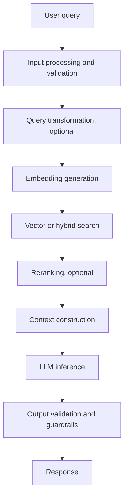
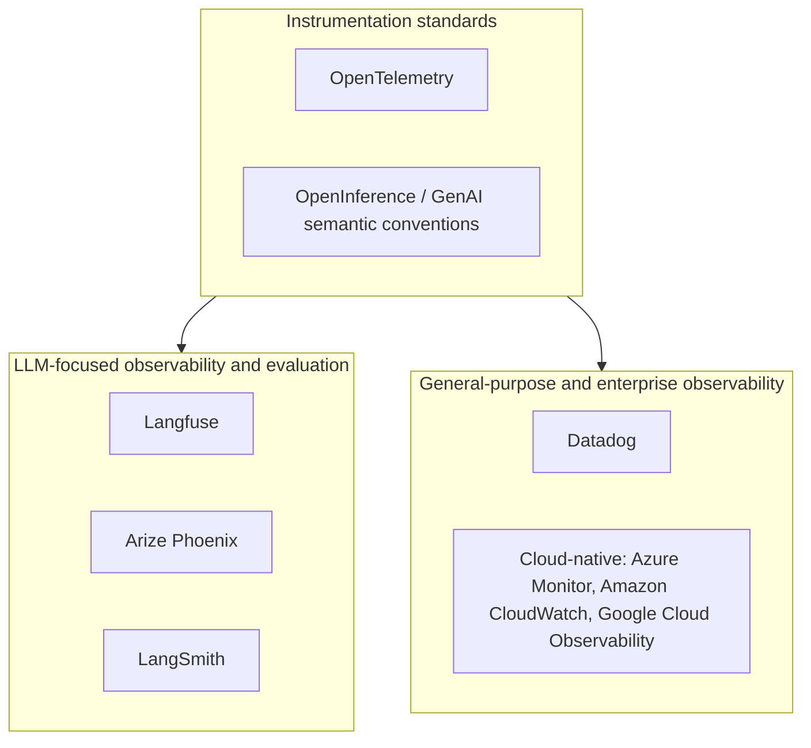
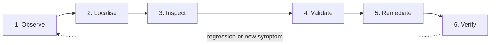
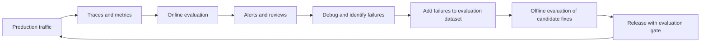
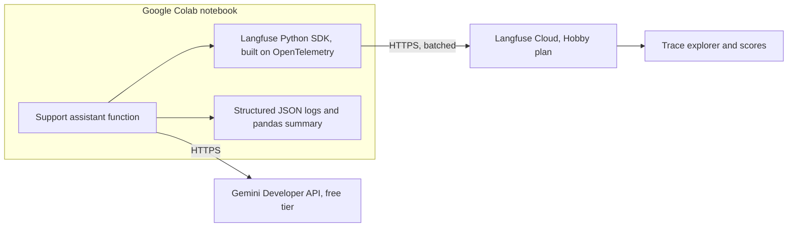
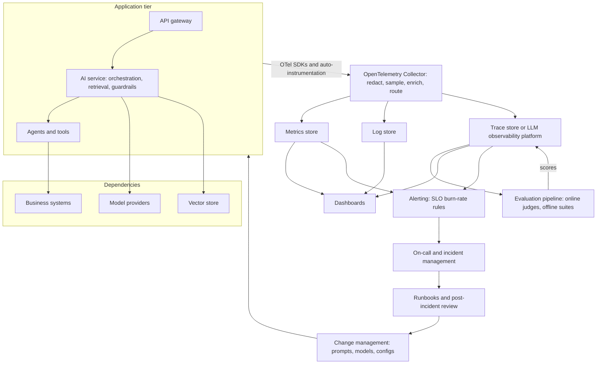

# Monitoring and Logging AI Systems

**A practical learning module for the Advanced Gen AI programme**

| | |
|---|---|
| **Audience** | Senior technology and business professionals; useful also for AI engineers, architects, and technical leads |
| **Prerequisites** | General familiarity with how LLM applications work (prompt in, response out). No observability background required. |
| **Companion material** | [monitoring_logging_ai_systems.ipynb](monitoring_logging_ai_systems.ipynb) (live demonstration), [references.md](references.md) (further reading) |
| **Content verified** | 11 October 2026. Product features, free tiers, and prices change; re-verify before making decisions. |

---

## How to Use This Module

The module is organised so that each section builds on the previous one:

1. **Sections 1–3** establish *why* AI systems need more than conventional monitoring and define the core vocabulary.
2. **Sections 4–5** describe *what* to measure, including the additional signals required for retrieval-augmented generation (RAG) and agentic systems.
3. **Section 6** surveys the *tools* and provides a framework for choosing between them.
4. **Section 7** presents a repeatable *debugging methodology*, the most transferable skill in this module.
5. **Sections 8–10** cover *operating* AI observability in an enterprise: alerting, governance, and architecture.
6. **Section 11** condenses everything into checklists.

Callouts are used sparingly to flag consequential information:

> **Important —** A fact or distinction that, if missed, leads to wrong conclusions.

> **Warning —** A practice that can cause harm, outages, or misleading results.

> **Best Practice —** A recommended approach with broad applicability.

> **Common Pitfall —** A mistake frequently made by experienced teams.

> **Security Consideration —** A privacy, security, or compliance implication.

Numerical examples are marked **(illustrative)** when they are invented to explain a concept. They are not benchmarks, recommendations, or vendor figures.

---

## Contents

1. [Why AI Observability Matters](#1-why-ai-observability-matters)
2. [Core Terminology and Conceptual Foundations](#2-core-terminology-and-conceptual-foundations)
3. [Traditional Monitoring versus GenAI Observability](#3-traditional-monitoring-versus-genai-observability)
4. [What to Measure](#4-what-to-measure)
5. [Monitoring RAG and Agentic Systems](#5-monitoring-rag-and-agentic-systems)
6. [Observability Tools and Platforms](#6-observability-tools-and-platforms)
7. [A Systematic Debugging Methodology](#7-a-systematic-debugging-methodology)
8. [Alerting and Reliability Engineering](#8-alerting-and-reliability-engineering)
9. [Security, Privacy, and Governance](#9-security-privacy-and-governance)
10. [Enterprise Monitoring Architecture](#10-enterprise-monitoring-architecture)
11. [Operational Checklists and Key Takeaways](#11-operational-checklists-and-key-takeaways)
- [Appendix A — Glossary](#appendix-a--glossary)
- [Appendix B — Example Structured Log Schema](#appendix-b--example-structured-log-schema)
- [Appendix C — Verification Notes](#appendix-c--verification-notes)

---

## 1. Why AI Observability Matters

### 1.1 The running example

Throughout this module, a single fictional system is used to ground the concepts: the **Acme Retail Support Assistant**, a customer-support chatbot built with retrieval-augmented generation (RAG).

> **Retrieval-augmented generation (RAG)** is a pattern in which an application first retrieves relevant documents (for example, company policies) and then supplies them to a large language model (LLM) as context, so the model answers from that material rather than from its general training data.

A request to the assistant passes through several stages:



Every stage can fail independently, and several can fail *without raising an error*.

### 1.2 Is the system healthy?

Consider the following situation **(illustrative)**:

- The service is up. The health check passes. Every request returns HTTP 200.
- Over the past week, median response time rose from 2 seconds to 8 seconds.
- Token consumption per request roughly tripled.
- A growing share of answers quote an incorrect refund window.

By conventional application metrics, nothing is wrong. From the customer's and the business's perspective, the system is failing on speed, cost, and correctness at the same time.

> **Important —** An HTTP 200 status code tells you that a request completed without a protocol-level error. It says nothing about whether the answer was correct, grounded in the right documents, safe, or affordable. AI systems can fail *silently*: the infrastructure is healthy while the product is not.

### 1.3 Seven layers of health

A useful way to reason about AI system health is to separate it into layers. Each layer asks a different question, fails in a different way, and requires different signals.

| Layer | Question | Example failure | Example signal |
|---|---|---|---|
| **Infrastructure availability** | Are the servers, containers, and network up? | Container out of memory; DNS failure | Uptime probes, CPU/memory, restart counts |
| **Application reliability** | Does our code execute correctly? | Unhandled exception in output formatting | Error rate by type, exception logs |
| **Model and provider reliability** | Is the model API responding within limits? | Rate limiting (HTTP 429), provider outage, timeout | Provider error codes, model-call latency, retry counts |
| **Retrieval quality** | Did we fetch the right context? | Index not refreshed; wrong filter after a config change | Documents returned per query, retrieval relevance scores |
| **Response quality and groundedness** | Is the answer correct and supported by the retrieved context? | Plausible but wrong answer; fabricated policy detail | Evaluation scores, user feedback, escalation rate |
| **Safety and policy compliance** | Is the answer appropriate and within policy? | Disclosure of personal data; response to a prompt-injection attempt | Guardrail triggers, policy-violation rate |
| **Cost and performance** | Is the system fast and affordable enough? | Context growth multiplies tokens; retry loops | Tokens per request, cost per successful task, p95 latency |

The first three layers are covered, at least partially, by conventional application performance monitoring (APM). The last four are specific to AI systems and are where most "silent" failures occur.

### 1.4 Why the gap exists

Three properties of LLM applications create the gap between "running" and "working":

1. **Non-determinism.** The same input can produce different outputs. A single successful test does not prove consistent behaviour.
2. **Semantic failure.** Failures are often in *meaning* rather than *mechanics*. A wrong answer is syntactically indistinguishable from a right one.
3. **Usage-based cost.** Cost scales with tokens, not with requests or servers. Small changes in prompt construction can multiply spend without changing traffic.

Observability for AI systems therefore has to answer *"Did it work well?"* in addition to *"Did it run?"*

---

## 2. Core Terminology and Conceptual Foundations

### 2.1 Definitions

These terms are often used interchangeably. They are related but distinct.

| Term | Definition | The question it answers |
|---|---|---|
| **Telemetry** | Data a system emits about its own behaviour: logs, metrics, and traces. | — (the raw material) |
| **Instrumentation** | Code or configuration that produces telemetry. | "What data does the system emit?" |
| **Logging** | Recording discrete, timestamped events. | "What happened, and when?" |
| **Metrics** | Numeric measurements aggregated over time. | "How much, how fast, how often?" |
| **Distributed tracing** | Recording the path and timing of a single request across components. | "Where did this request spend its time, and where did it fail?" |
| **Monitoring** | Continuously collecting and checking known indicators against expectations. | "Is the system behaving as expected right now?" |
| **Observability** | The degree to which a system's internal state can be inferred from its external outputs, including for failure modes nobody anticipated. | "Why is the system behaving this way?" |
| **Evaluation** | Measuring output quality against a defined criterion (correctness, groundedness, safety). | "Was the output good?" |
| **Alerting** | Notifying a human or automation when a condition requires action. | "Who needs to act, and when?" |
| **Debugging** | The investigative process of finding and fixing the cause of a problem. | "What is the cause, and what is the fix?" |
| **Reliability engineering** | The discipline of defining, measuring, and defending service reliability targets (SLIs, SLOs, error budgets). | "How reliable must this be, and are we meeting it?" |

The OpenTelemetry project describes observability as the ability to "understand a system from the outside by letting you ask questions about that system without knowing its inner workings," including novel problems ("unknown unknowns") ([OpenTelemetry Observability Primer](https://opentelemetry.io/docs/concepts/observability-primer/)).

### 2.2 How the concepts relate



- **Monitoring** is a subset of what good observability enables. Monitoring answers questions you anticipated; observability lets you answer ones you did not.
- **Evaluation** produces quality measurements that become telemetry. Once evaluation scores are attached to traces and aggregated into metrics, quality can be monitored like latency.
- **Alerting** is the bridge from data to human action. Without it, dashboards are passive.

> **Important —** Observability is a *property* of a system, not a product. A tool can store and display telemetry, but if the application does not emit the right data, no tool can make it observable.

### 2.3 The three telemetry signals

#### Logs — what happened

A **log** is a timestamped record of a discrete event. Modern systems use **structured logs**: machine-parsable records (usually JSON) with consistent field names, rather than free-text sentences.

Unstructured:

```text
2026-10-11 09:14:02 ERROR Model call failed for user after 5s
```

Structured:

```json
{
  "ts": "2026-10-11T09:14:02.381Z",
  "level": "ERROR",
  "event": "model_call_failed",
  "request_id": "req-7f3a91c2",
  "trace_id": "4bf92f3577b34da6a3ce929d0e0e4736",
  "model": "gemini-3.5-flash-lite",
  "prompt_version": "refund-prompt-v1",
  "error_type": "TimeoutError",
  "duration_ms": 5003
}
```

The structured version can be filtered ("all `model_call_failed` events for `prompt_version=refund-prompt-v1`"), aggregated ("count by `error_type`"), and joined to traces via `trace_id`.

> **Best Practice —** Log in a structured format from day one. Retrofitting structure onto free-text logs is expensive, and free-text logs cannot be reliably aggregated.

#### Metrics — how the system is performing overall

A **metric** is a numeric value aggregated over a time window: request count per minute, error rate, 95th-percentile latency, tokens per request. Metrics are cheap to store and fast to query, which makes them the natural basis for dashboards and alerts. They deliberately discard per-request detail.

Common metric types:

| Type | Behaviour | Example |
|---|---|---|
| **Counter** | Only increases | Total requests; total tokens consumed |
| **Gauge** | Goes up and down | Current queue depth; active sessions |
| **Histogram** | Distribution of values in buckets | Request latency, from which percentiles are derived |

#### Traces — where the time went

A **trace** records the path of a single request through the system as a tree of **spans**. Each span represents one unit of work (a retrieval call, an LLM call, a tool invocation) with a start time, end time, name, attributes, and status.

An illustrative trace for one assistant request **(illustrative timings)**:

```text
support-request                          [=============================] 4,210 ms
├─ validate-input                        [=]                                 3 ms
├─ retrieve-context                      [==]                              180 ms
├─ build-prompt                          [=]                                 2 ms
├─ llm-generate  (model call)                [========================]  3,950 ms
└─ postprocess                                                       [=]    75 ms
```

The trace immediately shows that model inference dominates latency. Metrics would have shown only that the request was slow.

#### How the three signals complement each other

> **Metrics tell you *that* something is wrong. Traces tell you *where*. Logs tell you *what exactly* happened at that point.**

A typical investigation moves from a metric (p95 latency rose), to a set of slow traces (the model call is the slow span), to the logs and attributes on those spans (a new prompt version doubled the input size).

### 2.4 Anatomy of a trace

| Concept | Meaning |
|---|---|
| **Trace ID** | A unique identifier shared by every span in one request. In the [W3C Trace Context](https://www.w3.org/TR/trace-context/) standard it is a 32-character hexadecimal string. |
| **Span ID** | A unique identifier for one span (16 hexadecimal characters in W3C Trace Context). |
| **Parent span ID** | Links a child span to the span that caused it, forming the tree. The first span, with no parent, is the **root span**. |
| **Attributes** | Key–value metadata on a span, such as `model`, `prompt_version`, `retrieved_doc_count`. |
| **Events** | Timestamped annotations within a span (for example, "retry attempt 2"). |
| **Status** | Whether the span completed successfully or with an error, plus an optional message. |
| **Context propagation** | Passing the trace ID and parent span ID across process and network boundaries (typically via the `traceparent` HTTP header) so that spans from different services join the same trace. |

A **correlation ID** (or request ID) is an application-level identifier attached to logs and user-facing records. It serves a similar purpose to a trace ID but is not tied to a tracing standard. In practice, log the trace ID alongside any business identifier (ticket number, order ID) so that a support complaint can be traced back to telemetry.

> **Common Pitfall —** Generating a new ID at each service boundary. If the trace ID is not propagated, a single user request appears as several unrelated fragments, and cross-component debugging becomes guesswork.

Timestamps deserve care. Spans from different machines are compared by timestamp, so clock drift between hosts can make a child appear to start before its parent. Use UTC and synchronised clocks, and treat sub-millisecond ordering across machines with scepticism.

### 2.5 The telemetry lifecycle



1. **Instrument** — add code (or auto-instrumentation libraries) that emits telemetry.
2. **Collect** — gather telemetry from many processes, often via an agent or collector.
3. **Process** — redact sensitive data, sample, enrich with environment metadata, route to destinations.
4. **Store** — persist in systems optimised for each signal (time-series databases for metrics, search indexes for logs, trace stores).
5. **Query and visualise** — dashboards, trace views, ad-hoc queries.
6. **Alert** — evaluate rules and notify owners.
7. **Respond** — investigate, mitigate, and fix.
8. **Improve** — each incident usually reveals missing instrumentation; add it.

### 2.6 Cardinality

**Cardinality** is the number of distinct values a field can take. `model` has low cardinality (a handful of values); `user_id` or `request_id` has very high cardinality.

> **Common Pitfall —** Adding high-cardinality fields (user IDs, request IDs, raw prompt text) as *metric labels*. Each distinct label combination creates a separate time series, which can overwhelm metric stores and inflate cost. Put high-cardinality identifiers on traces and logs; keep metric labels low-cardinality (model, prompt version, environment, outcome).

---

## 3. Traditional Monitoring versus GenAI Observability

### 3.1 How requirements evolve by system type

| Dimension | Conventional API | ML inference service | LLM application | RAG application | Agentic workflow |
|---|---|---|---|---|---|
| **Unit of work** | Request | Prediction | Prompt → completion | Query → retrieval → completion | Goal → many steps, tools, and model calls |
| **Determinism** | Deterministic | Deterministic for a fixed model | Non-deterministic | Non-deterministic; also depends on index state | Non-deterministic; path varies per run |
| **What "failure" means** | Error code, timeout | Wrong prediction, data drift | Error, *or* poor/unsafe answer | Error, wrong context, *or* ungrounded answer | Error, wrong tool, loop, *or* wrong outcome |
| **Ground truth availability** | Usually implicit (contract) | Delayed labels | Rarely available at runtime | Rarely available at runtime | Rarely available at runtime |
| **Primary cost driver** | Compute | Compute | Tokens | Tokens + retrieval infrastructure | Tokens × number of steps |
| **Key additional signals** | Golden signals | + feature/prediction drift, model accuracy | + tokens, model version, prompt version, quality scores | + retrieval relevance, context size, groundedness | + steps per task, tool errors, loop detection, task success |
| **Most useful debugging artefact** | Logs, APM trace | Prediction logs, feature distributions | Prompt/response trace with usage | Trace including retrieved documents | Full nested trace of the decision path |

### 3.2 What remains necessary

Google's Site Reliability Engineering book identifies four **golden signals** for user-facing systems: **latency, traffic, errors, and saturation** ([Google SRE Book, Chapter 6](https://sre.google/sre-book/monitoring-distributed-systems/)). All four remain essential for AI systems.

Notably, that chapter already defines errors to include "an HTTP 200 success response, but coupled with the wrong content." AI observability makes this category the centre of attention rather than an edge case.

### 3.3 What must be added

| Added signal | Why conventional monitoring misses it |
|---|---|
| Token usage (input, output, reasoning) | Cost and latency driver invisible to CPU/memory metrics |
| Model identifier and parameters | Behaviour changes when the model or its version changes |
| Prompt/template version | A prompt edit is a code change with no build step |
| Retrieved context (identifiers, scores, count) | Retrieval can return the wrong documents without erroring |
| Quality and safety evaluation scores | The only way to detect semantic failure |
| User feedback and escalation | Ground-truth proxy from real users |
| Step and tool-call counts (agents) | Loops and redundant calls hide inside one top-level request |

> **Important —** GenAI observability *supplements* infrastructure and application monitoring; it does not replace it. A provider outage, a memory leak, or a misconfigured load balancer still needs conventional monitoring to detect.

---

## 4. What to Measure

### 4.1 Principles of good metrics

1. **Measure from the user's perspective.** "Fraction of requests answered correctly within 3 seconds" matters more than average CPU.
2. **Prefer ratios of good events to total events.** They normalise for traffic and translate directly into service level indicators (Section 8).
3. **Measure distributions, not just averages.** Percentiles expose the tail that averages hide.
4. **Segment by low-cardinality dimensions.** Model, prompt version, environment, request type, and outcome.
5. **Every metric should have a use.** If a metric is not on a dashboard, in an alert, or used in a review, question why it is collected.

### 4.2 Application and infrastructure

| Metric | Definition | Notes |
|---|---|---|
| **Request volume / throughput** | Requests per unit time | Segment by endpoint and request type |
| **Error rate** | $\dfrac{\text{failed requests}}{\text{total requests}}$ | Break down by error class (validation, provider, application, timeout) |
| **Availability** | $\dfrac{\text{successful requests}}{\text{valid requests}}$ over a window | Define "successful" explicitly; see Section 8 |
| **Saturation** | Utilisation of the most constrained resource | For LLM apps this is often provider rate limits, not CPU |
| **Dependency health** | Error rate and latency of each dependency (model API, vector store, databases) | Distinguishes "our bug" from "their outage" |

### 4.3 Latency and performance

| Metric | Definition | When it matters |
|---|---|---|
| **End-to-end latency** | Time from request receipt to response completion | Always |
| **Time to first token (TTFT)** | Time from request to the first streamed output token | Streaming interfaces; governs *perceived* responsiveness |
| **Per-step latency** | Duration of each span (retrieval, model call, post-processing) | Localising slowness |
| **Percentiles (p50, p95, p99)** | The value below which 50%, 95%, or 99% of measurements fall | Understanding typical versus worst-case experience |
| **Queueing time** | Time waiting before processing begins | Under load or concurrency limits |
| **Timeouts and retries** | Count and rate of timed-out and retried calls | Retries can hide failures while multiplying cost and latency |

**Why averages mislead (illustrative).** Suppose 100 requests take the following times: 90 requests at 1.0 s, 9 at 3.0 s, and 1 at 30.0 s.

- Mean: $(90 \times 1.0 + 9 \times 3.0 + 1 \times 30.0) / 100 = 1.47$ s
- p50 (median): 1.0 s
- p95: 3.0 s
- p99: 3.0 s; the maximum is 30.0 s

The mean of 1.47 s describes no actual user's experience. The p95 tells you that one user in twenty waits about three times as long as the typical user.

> **Important —** A p95 latency of 4 seconds means that approximately 95% of measured requests completed in 4 seconds or less. Percentiles computed from small samples are unstable; with 20 requests, "p95" is determined by a single data point.

Google's SRE guidance makes the same point: a service with 100 ms average latency at 1,000 requests per second "might easily" have 1% of requests taking 5 seconds ([Google SRE Book, Chapter 6](https://sre.google/sre-book/monitoring-distributed-systems/)).

### 4.4 LLM usage and economics

| Metric | Definition |
|---|---|
| **Input tokens** | Tokens in the prompt, including system instructions, retrieved context, and conversation history |
| **Output tokens** | Tokens generated in the response |
| **Reasoning ("thinking") tokens** | Tokens some models generate internally before answering; often billed as output |
| **Total tokens per request** | Sum of the above, as reported by the provider |
| **Context-window utilisation** | $\dfrac{\text{input tokens}}{\text{model input token limit}}$ |
| **Cost per request** | $(\text{input tokens} \times p_{in} + \text{output tokens} \times p_{out}) / 10^6$, where $p$ is the price per million tokens |
| **Cost per successful task** | $\dfrac{\text{total cost of all attempts}}{\text{number of successfully completed tasks}}$ |
| **Retry and repeat overhead** | Tokens consumed by retries or duplicated calls as a share of total |

Cost per *successful task* is more meaningful than cost per request. If a cheaper model requires three attempts to reach an acceptable answer, it may cost more per resolved customer query than a more expensive model that succeeds first time.

Three kinds of token numbers appear in practice, and they must not be confused:

| Kind | Source | Reliability |
|---|---|---|
| **Provider-reported usage** | Returned in the API response (for example, the Gemini Interactions API exposes `usage.total_input_tokens`, `total_output_tokens`, `total_thought_tokens`, `total_tokens` per the [token documentation](https://ai.google.dev/gemini-api/docs/tokens)) | Authoritative for billing purposes |
| **Estimated tokens** | Computed locally, for example the heuristic "about 4 characters per token" for Gemini models | Approximate; varies by language and content |
| **Illustrative cost** | Tokens multiplied by a list price | Only as accurate as the price used; excludes discounts, free tiers, caching, and batch pricing |

> **Warning —** Do not present estimated tokens or list-price calculations as actual spend. Free tiers, committed-use discounts, cached-input pricing, and batch pricing all change the real figure. Reconcile against the provider's billing data.

Why the relationship between input size, tokens, latency, and cost is **not linear**:

- Output length, not input length, usually dominates generation time, because output tokens are produced sequentially.
- Reasoning models may spend a variable number of thinking tokens regardless of input size.
- Input and output tokens are typically priced differently; output is often several times more expensive per token.
- Context caching and batch modes change effective prices.
- Provider-side load introduces latency variance unrelated to the request.

### 4.5 Quality and safety

| Metric | Definition | Typical method |
|---|---|---|
| **Task success rate** | Share of interactions that achieved the user's goal | Explicit outcome signal, human review, or LLM-as-judge |
| **Groundedness / faithfulness** | Share of answer claims supported by the retrieved context | LLM-as-judge or natural-language-inference models |
| **Answer relevance** | Whether the answer addresses the question asked | LLM-as-judge, embedding similarity |
| **Retrieval quality** | Whether retrieved documents are relevant and sufficient (see Section 5.3) | Labelled evaluation sets; LLM-as-judge on retrieved chunks |
| **Structured-output validity** | Share of outputs that parse against the expected schema | Deterministic code check |
| **Evaluation pass rate** | $\dfrac{\text{evaluated outputs passing a criterion}}{\text{evaluated outputs}}$ | Any evaluator; specify which criterion |
| **Safety / policy violation rate** | Share of outputs flagged by guardrails or reviewers | Classifiers, rules, human review |
| **User feedback rate** | Thumbs up/down, ratings, as a share of interactions | In-product feedback |
| **Escalation rate** | Share of conversations handed to a human agent | Business system events |

**Evaluation methods** fall into four broad families ([LangSmith evaluation concepts](https://docs.langchain.com/langsmith/evaluation-concepts)):

| Method | Strengths | Limitations |
|---|---|---|
| **Code (deterministic) checks** | Cheap, fast, reproducible | Only for objectively checkable properties (format, required facts, length) |
| **LLM-as-judge** | Scales to subjective criteria (helpfulness, groundedness) | The judge is itself a model: it can be biased, inconsistent, and must be validated against human labels |
| **Human review** | Highest validity for nuanced judgements | Slow, expensive, does not scale to all traffic |
| **User feedback** | Reflects real user experience | Sparse, biased toward strong reactions, delayed |

Evaluators are either **reference-based** (compare against a known correct answer; possible mainly offline, on curated datasets) or **reference-free** (judge properties such as safety, format, or groundedness against retrieved context; usable on live traffic).

> **Common Pitfall —** Relying on a single quality metric. Optimising for one measure (for example, answer length or a single judge score) invites Goodhart's law: the measure improves while the real outcome does not. Use a small set of complementary measures and periodically validate them against human judgement.

### 4.6 Drift and regression

**Drift** is a change in the statistical properties of inputs or outputs over time. **Regression** is a degradation caused by a change you made.

| What changes | What to watch |
|---|---|
| **Input distribution** | Topic mix, query length, language, new intents not covered by the knowledge base |
| **Retrieval results** | Document hit distribution, average relevance score, empty-result rate |
| **Model** | Provider model version updates, model swaps, parameter changes |
| **Prompt and configuration** | Prompt template versions, retrieval settings (top-k, filters), feature flags |
| **Quality over time** | Evaluation scores on a fixed reference dataset, run on a schedule |
| **Performance before and after deployment** | Latency, tokens, and quality compared across versions |

> **Best Practice —** Attach version identifiers (application version, prompt version, model ID, retrieval/index version) to every trace. Without them, a quality drop after deployment cannot be attributed to a specific change.

### 4.7 Setting thresholds

There are no universal thresholds for AI system metrics. A 5-second response may be excellent for a research assistant and unacceptable for an autocomplete feature.

Derive thresholds from:

1. **User and business requirements** — what experience is acceptable, and what does failure cost?
2. **Observed baselines** — measure normal behaviour for at least several days before alerting.
3. **Service level objectives** — thresholds should protect an explicit target (Section 8).
4. **Variance** — set thresholds relative to normal variation, not single observations.

> **Warning —** Copying thresholds from blog posts, vendor defaults, or other teams. A threshold that is not tied to your users' needs and your system's baseline produces either alert fatigue or missed incidents.

---

## 5. Monitoring RAG and Agentic Systems

### 5.1 The RAG execution path



What to record at each stage:

| Stage | Record | Common failure |
|---|---|---|
| **Input processing** | Input length, language, validation outcome, guardrail result | Oversized or malicious input passes through |
| **Query transformation** | Original and rewritten query | Rewriting loses the user's intent |
| **Embedding generation** | Embedding model and version, latency | Embedding model changed without re-indexing |
| **Retrieval** | Document IDs, similarity scores, count, filters applied, index version | Empty or irrelevant results; stale index; wrong tenant filter |
| **Reranking** | Pre- and post-rerank order and scores | Reranker demotes the relevant document |
| **Context construction** | Number of chunks included, total context tokens, truncation | Relevant chunk truncated to fit the context window |
| **LLM inference** | Model, parameters, prompt version, token usage, latency, finish reason | Slow, expensive, or ignores context |
| **Output validation** | Schema validity, guardrail outcome, citations present | Invalid structure; unsafe content; missing citations |

### 5.2 Using traces to find a slow stage or missing context

An illustrative RAG trace **(illustrative timings)**:

```text
support-request                               6,840 ms   status=OK
├─ validate-input                                 4 ms
├─ retrieve-context        (retriever)        4,920 ms   docs=0   index=policies-v12
├─ build-prompt                                   3 ms   context_tokens=12
├─ llm-generate            (generation)       1,850 ms   in=210 out=64
└─ postprocess                                   63 ms
```

Reading this trace:

- **Latency:** retrieval, not the model, consumed most of the time. Optimising the prompt or switching to a faster model would not help.
- **Quality:** `docs=0` and `context_tokens=12` show that the model received effectively no context. Any answer is ungrounded, even though the request succeeded.
- **Version:** `index=policies-v12` points to a specific index build to investigate.

### 5.3 Retrieval evaluation versus answer evaluation

Retrieval quality and answer quality must be evaluated separately, because they fail independently.

| | **Answer good** | **Answer poor** |
|---|---|---|
| **Retrieval good** | Healthy | Generation problem: prompt, model, or context construction |
| **Retrieval poor** | Model answered from general knowledge; correct by luck and fragile | Retrieval problem: fix retrieval first |

Common retrieval measures (computed on a labelled evaluation set where relevant documents are known):

- **Hit rate (recall@k):** share of queries where at least one relevant document appears in the top *k* results.
- **Context precision:** share of retrieved chunks that are relevant.
- **Context recall:** share of the information needed to answer that is present in the retrieved context.
- **Mean reciprocal rank (MRR):** average of $1/\text{rank}$ of the first relevant document.

Libraries such as [Ragas](https://docs.ragas.io/) implement these and related RAG metrics; observability platforms in Section 6 can store their results as scores on traces.

### 5.4 Agentic systems

An **agent** is an LLM-driven system that decides which actions to take (tool calls, further model calls, sub-agent delegation) in pursuit of a goal. Its execution path is not fixed in advance, which makes tracing essential.

Agent-specific concerns:

| Concern | What to observe |
|---|---|
| **Nested model calls** | Every LLM call within the task, with its purpose and token usage |
| **Tool invocations** | Tool name, arguments, result summary, latency, success or failure |
| **Retries** | Which step retried, why, and how many times |
| **Workflow state** | Plan, intermediate decisions, memory reads and writes |
| **Termination** | Why the agent stopped: goal achieved, step limit reached, error, or user interruption |
| **Aggregate measures** | Steps per task, tool error rate, tokens per task, task success rate |

An illustrative agent trace **(illustrative)**:

```text
agent-task "Process refund for order 1182"            41,300 ms   steps=14
├─ plan                    (generation)                 2,100 ms
├─ lookup_order            (tool)                         310 ms   ok
├─ check_refund_policy     (retriever)                    220 ms   ok
├─ decide                  (generation)                 1,900 ms
├─ issue_refund            (tool)                         450 ms   ERROR 409 already_refunded
├─ decide                  (generation)                 2,050 ms
├─ issue_refund            (tool)                         430 ms   ERROR 409 already_refunded
├─ decide                  (generation)                 2,010 ms
├─ issue_refund            (tool)                         440 ms   ERROR 409 already_refunded
│  ... (pattern repeats)
└─ terminated: max_steps reached
```

**Expected iteration versus pathological behaviour.** Agents legitimately iterate: a search that returns nothing may reasonably be retried with a different query. The pattern above is pathological because the *same tool* is called with the *same arguments* and receives the *same error*, and the agent does not change strategy.

Signals that distinguish the two:

- Repeated identical tool calls (same name and arguments) within one task
- Step count far above the baseline for that task type
- Token usage per task far above baseline
- A tool error that the agent never handles differently

> **Best Practice —** Enforce hard limits on agent steps, tool calls, tokens, and wall-clock time per task, and record which limit terminated the run. Limits convert unbounded failures (cost explosions, infinite loops) into bounded, observable ones. The OWASP Top 10 for LLM Applications lists [Unbounded Consumption (LLM10:2025)](https://genai.owasp.org/llmrisk/llm102025-unbounded-consumption/) and [Excessive Agency (LLM06:2025)](https://genai.owasp.org/llmrisk/llm062025-excessive-agency/) as distinct risk categories.

> **Important —** A single top-level latency or cost metric for an agent hides everything inside it. A task that "succeeds" after 14 steps and 40 seconds may be a defect, not a success.

---

## 6. Observability Tools and Platforms

### 6.1 Three layers of tooling

It is useful to separate tools by the problem they solve:



1. **Instrumentation standards** define *how* telemetry is produced and transported. They are not where you look at data.
2. **LLM-focused platforms** specialise in prompt/response inspection, token and cost tracking, evaluation, datasets, and experiments.
3. **General-purpose and enterprise platforms** unify AI telemetry with infrastructure, application, and security monitoring.

Most mature organisations use a combination: a standard for instrumentation, plus one or more backends.

### 6.2 OpenTelemetry

[OpenTelemetry](https://opentelemetry.io/docs/) (OTel) is a vendor-neutral, open-source project under the Cloud Native Computing Foundation that provides APIs, SDKs, a wire protocol (OTLP), and the **OpenTelemetry Collector** for producing, processing, and exporting traces, metrics, and logs.

| Aspect | Summary |
|---|---|
| **Primary purpose** | Standardised instrumentation and telemetry transport |
| **Typical use** | Instrument once; send telemetry to one or more compatible backends |
| **Instrumentation approach** | Language SDKs, auto-instrumentation libraries, manual spans |
| **Visualisation** | None of its own; relies on a backend |
| **GenAI support** | GenAI semantic conventions (standard attribute names such as `gen_ai.*`) are maintained in a dedicated repository, [open-telemetry/semantic-conventions-genai](https://github.com/open-telemetry/semantic-conventions-genai) |
| **Hosting** | Runs inside your application and infrastructure |
| **Licence** | Apache 2.0 |
| **Limitations** | Requires a backend; GenAI conventions are still evolving, so attribute names and coverage vary between tools |

> **Important —** OpenTelemetry is an instrumentation standard and ecosystem, **not** an observability backend. It produces and moves telemetry; it does not store, visualise, or alert on it. "We use OpenTelemetry" answers how data is collected, not where it is analysed.

Its main strategic benefit is **portability**: application code instrumented with OTel can switch or add backends through configuration rather than code changes. Major backends, including Langfuse, Phoenix, Datadog, Amazon CloudWatch, and Azure Monitor, accept OpenTelemetry data.

### 6.3 OpenInference

[OpenInference](https://github.com/Arize-ai/openinference) is a set of conventions and instrumentation plugins, complementary to OpenTelemetry, for tracing AI applications. It provides ready-made auto-instrumentation for many LLM SDKs and frameworks (OpenAI, Anthropic, Google GenAI, LangChain, LlamaIndex, and others). It is natively supported by Arize Phoenix and can be used with any OpenTelemetry-compatible backend.

OpenInference and the OpenTelemetry GenAI semantic conventions address overlapping needs. Check which conventions your chosen backend understands best.

### 6.4 Langfuse

[Langfuse](https://langfuse.com/docs) is an open-source LLM engineering platform covering tracing, prompt management, evaluation, datasets, and metrics.

| Aspect | Summary |
|---|---|
| **Primary purpose** | LLM application tracing, evaluation, and prompt management |
| **Instrumentation** | Python and JS/TS SDKs built on OpenTelemetry; native integrations for popular frameworks; accepts OTLP from other languages |
| **Trace visualisation** | Nested trace tree with typed observations (span, generation, retriever, tool, agent, evaluator, guardrail, and others) |
| **Prompt/response visibility** | Full inputs and outputs per observation, subject to masking configuration |
| **Token and cost tracking** | Records usage per generation; infers cost from model price definitions or accepts explicit cost |
| **Evaluation** | Scores via SDK/API, LLM-as-judge, human annotation, datasets, and experiments |
| **Data control** | Managed cloud (EU, US, Japan, HIPAA regions) or self-hosted; client-side masking and sampling |
| **Operational complexity** | Low for cloud; self-hosting requires running several services |
| **Licence** | Open-source core (MIT); some enterprise features commercial |
| **Free option (verified 11 Oct 2026)** | Cloud **Hobby** plan: no credit card, 50k billable units/month, 30 days data access, 2 users ([pricing](https://langfuse.com/pricing)); self-hosting is free of licence cost |

Langfuse is used in the companion notebook.

### 6.5 Arize Phoenix

[Arize Phoenix](https://arize.com/docs/phoenix) is an open-source AI observability and evaluation tool built by Arize AI, built on OpenTelemetry and powered by OpenInference instrumentation.

| Aspect | Summary |
|---|---|
| **Primary purpose** | Tracing, evaluation, datasets, experiments, and prompt iteration |
| **Instrumentation** | OTLP ingestion; OpenInference auto-instrumentation for many frameworks and providers |
| **Evaluation** | LLM-based evaluators, code checks, human annotations; integrations with Ragas, DeepEval, Cleanlab |
| **Data control** | Can run locally or self-hosted; Arize also offers a managed enterprise platform (Arize AX) |
| **Strength** | Strong emphasis on systematic evaluation and experimentation alongside tracing |
| **Limitations** | Self-hosting means operating it yourself; verify current hosted offerings and limits before relying on them |

### 6.6 LangSmith

[LangSmith](https://docs.langchain.com/langsmith/home) is LangChain's platform for tracing, debugging, evaluation, and monitoring LLM applications.

| Aspect | Summary |
|---|---|
| **Primary purpose** | Tracing and evaluating LLM workflows; closely integrated with LangChain and LangGraph |
| **Instrumentation** | SDKs and decorators; native LangChain/LangGraph integration; usable without LangChain |
| **Evaluation** | Datasets, experiments, offline and online evaluators (code, LLM-as-judge, human, pairwise), annotation queues |
| **Data control** | Managed cloud; self-hosted options for enterprise |
| **Strength** | Mature evaluation workflow and tight integration for LangChain-based teams |
| **Limitations** | Commercial pricing model (seats and usage); verify current plan limits |

LangSmith's documentation provides a clear distinction between **offline evaluation** (on curated datasets with reference outputs, before deployment) and **online evaluation** (on production traces, without reference outputs) ([evaluation concepts](https://docs.langchain.com/langsmith/evaluation-concepts)).

### 6.7 Datadog LLM Observability

[Datadog's LLM Observability product](https://docs.datadoghq.com/llm_observability/) (presented in its documentation as **Agent Observability** at the time of verification) extends Datadog's APM and infrastructure platform to LLM applications and agents.

| Aspect | Summary |
|---|---|
| **Primary purpose** | AI tracing within a unified enterprise observability platform |
| **Instrumentation** | Python SDK with auto-instrumentation for common frameworks; supports OpenTelemetry GenAI semantic conventions |
| **Capabilities** | End-to-end traces, operational dashboards (cost, latency, tokens, errors), quality evaluations, sensitive-data scanning, prompt-injection detection |
| **Strength** | Correlates AI behaviour with infrastructure, APM, logs, and security in one place |
| **Pricing model** | Metered on LLM spans ingested; commercial |
| **Limitations** | Commercial; most attractive if the organisation already standardises on Datadog |

### 6.8 Cloud-native observability

Each major cloud provider offers integrated observability that increasingly supports OpenTelemetry and AI workloads:

- **Microsoft Azure** — [Azure Monitor](https://learn.microsoft.com/en-us/azure/azure-monitor/), including Application Insights and OpenTelemetry-based instrumentation.
- **Amazon Web Services** — [Amazon CloudWatch](https://docs.aws.amazon.com/AmazonCloudWatch/latest/monitoring/WhatIsCloudWatch.html), which provides native OTLP endpoints and, at the time of verification, AI-agent monitoring features.
- **Google Cloud** — [Google Cloud Observability](https://cloud.google.com/stackdriver/docs) (Cloud Monitoring, Logging, and Trace).

These are strong defaults when the AI application runs on the same cloud, data residency must stay within that provider, or the organisation already operates them. Evaluate their LLM-specific depth (prompt inspection, evaluation workflows) against specialised platforms.

### 6.9 Comparison summary

| | OpenTelemetry | Langfuse | Arize Phoenix | LangSmith | Datadog | Cloud-native |
|---|---|---|---|---|---|---|
| **Category** | Standard | LLM platform | LLM platform | LLM platform | Enterprise APM | Enterprise cloud |
| **Stores and visualises data** | No | Yes | Yes | Yes | Yes | Yes |
| **Prompt/response inspection** | Via backend | Yes | Yes | Yes | Yes | Varies |
| **Token/cost tracking** | Via conventions | Yes | Yes | Yes | Yes | Varies |
| **Evaluation workflows** | No | Yes | Yes (strong) | Yes (strong) | Yes | Varies |
| **Infra/APM correlation** | Via backend | Limited | Limited | Limited | Strong | Strong |
| **Open source** | Yes | Yes (core) | Yes | No | No | No |
| **Self-hosting** | N/A (runs in your stack) | Yes | Yes | Enterprise | No | No (provider-managed) |
| **No-cost entry point** | Free software | Free cloud tier; free self-host | Free self-host | Verify current plan | Verify current offer | Verify current free tier |

> **Warning —** Feature coverage, hosting options, free tiers, and pricing change frequently. This table reflects documentation reviewed on 11 October 2026 and is a starting point for evaluation, not a procurement recommendation. Validate against current vendor documentation and contracts.

### 6.10 A decision framework

No platform is universally best. Use the following questions:

| Question | If the answer is... | Lean towards... |
|---|---|---|
| Must telemetry stay inside your own infrastructure? | Yes | Self-hosted open source (Langfuse, Phoenix) or your existing in-house stack |
| Do you already operate an enterprise APM or cloud observability platform? | Yes | Its AI capabilities first; add a specialised tool only for gaps |
| Is your application built primarily on LangChain/LangGraph? | Yes | LangSmith is a natural fit; others also integrate |
| Is systematic evaluation and experimentation the main need? | Yes | Platforms with strong dataset/experiment workflows (Phoenix, LangSmith, Langfuse) |
| Do you need to avoid vendor lock-in? | Yes | Instrument with OpenTelemetry/OpenInference; choose a backend that ingests OTLP |
| Is this a small team or proof of concept? | Yes | A managed free tier or a local open-source deployment |
| Are there strict compliance requirements (HIPAA, data residency, audit logs)? | Yes | Verify regional hosting, contractual terms, and enterprise features before adoption |

> **Best Practice —** Separate the instrumentation decision from the backend decision. Instrumenting with an open standard keeps the backend choice reversible.

---

## 7. A Systematic Debugging Methodology

Tools change; a disciplined investigation process does not. This section presents a six-step method that applies to any AI system and any toolset.

### 7.1 The six steps



| Step | Question | Activities | Primary signals |
|---|---|---|---|
| **1. Observe** | What changed? | Confirm the symptom; quantify scope (how many users, since when, which segments) | Metrics, alerts, user reports, evaluation trends |
| **2. Localise** | Where is the problem? | Narrow to a component: retrieval, model call, tool, post-processing, dependency | Traces, per-step latency and error metrics |
| **3. Inspect** | What happened in affected requests? | Examine inputs, outputs, retrieved context, versions, errors; compare with healthy requests | Trace details, structured logs, span attributes |
| **4. Validate** | Is the hypothesis supported by evidence? | Reproduce the issue; compare against a baseline or known-good version; test on an evaluation dataset | Reproduction runs, A/B comparison, offline evaluation |
| **5. Remediate** | What is the smallest justified fix? | Roll back, fix the defect, tune configuration, adjust prompt or model only if evidence supports it | Change records, version identifiers |
| **6. Verify** | Did the fix work, and did it break anything else? | Re-run evaluations; compare metrics before and after; monitor for regressions; document the incident | Metrics, evaluation scores, post-incident review |

### 7.2 Clues versus root causes

A trace or log entry is a **diagnostic clue**, not a confirmed root cause. A slow model span is consistent with provider latency, a larger prompt, a different model, or network issues. Only validation (Step 4) distinguishes them.

> **Important —** Treat every early explanation as a hypothesis. Write it down, state what evidence would confirm or refute it, and gather that evidence before changing the system.

### 7.3 Debugging decision table

| Symptom | Signals to check | Evidence to inspect | Plausible causes | How to validate | Possible remediations |
|---|---|---|---|---|---|
| **Increased latency** | p50/p95/p99 by step; TTFT; retries | Slow traces: which span grew? Input/output token counts on slow vs. normal requests | Provider slowdown; larger prompts; longer outputs; retrieval slowness; retries; model change | Compare per-span latency before/after; replay identical inputs; check provider status | Fix the slow component; cap output length; tune retrieval; adjust timeouts and retry policy; roll back |
| **Increased technical error rate** | Error rate by type and component | Error logs, provider error codes (for example 429, 5xx), stack traces | Rate limits; provider outage; deployment bug; invalid configuration; schema change | Correlate onset with deploys and provider status; reproduce in staging | Roll back; fix defect; backoff and quota management; fallback model |
| **Successful requests, incorrect answers** | Evaluation scores, user feedback, escalations | Retrieved context vs. answer; prompt version; model version | Retrieval regression; prompt change; model change; knowledge base out of date | Re-run a fixed evaluation set on old vs. new versions; inspect failing traces | Fix retrieval; roll back prompt; update content; add evaluation gate to deployment |
| **Irrelevant or missing retrieval context** | Empty-result rate, relevance scores, docs per query | Retrieved document IDs and scores; filters; index version | Stale index; embedding model mismatch; wrong filter; chunking change | Run retrieval evaluation set (hit rate, precision) against previous index | Re-index; revert filter or chunking; align embedding model versions |
| **Unexpected token or cost increase** | Tokens per request by component; requests per task; retry rate | Input composition (system prompt, context, history); output length; duplicate calls | Context growth; conversation history not truncated; retries; agent loops; model with more reasoning tokens | Diff prompt composition between periods; count calls per task | Truncate or summarise history; limit context; fix retries; set token budgets |
| **Agent loops / repeated tool calls** | Steps per task; repeated identical tool calls; tool error rate | Agent trace: tool names, arguments, results, decisions | Unhandled tool error; ambiguous tool description; missing termination condition | Replay the task; inspect the decision after each tool result | Handle tool errors explicitly; improve tool descriptions; add step limits and loop detection |
| **Regression after prompt or model change** | Quality, latency, and cost segmented by version | Paired traces for the same inputs across versions | The change itself; interaction with retrieval; changed output format breaking parsing | Offline evaluation on a reference dataset, old vs. new | Roll back; fix and re-evaluate; gate future changes on evaluation results |

### 7.4 Worked example: latency regression after deployment

**Symptom (illustrative):** after a Tuesday deployment, p95 latency rose from 2 s to 7 s.

A weak response is to switch immediately to a "faster" model or shorten the prompt. Neither is justified yet.

A disciplined investigation:

1. **Observe.** p95 rose at 14:05, matching the deployment. p50 rose only slightly, so the slowdown affects a subset of requests.
2. **Localise.** Comparing slow traces with normal ones shows the `retrieve-context` span grew from 200 ms to 5 s; the model span is unchanged.
3. **Inspect.** Slow traces all carry `retrieval_filter=region`. The deployment added a region filter.
4. **Validate.** Re-running a sample of queries with the filter disabled in staging restores normal retrieval latency. The vector store's query plan shows the new filter field is not indexed.
5. **Remediate.** Add an index on the filter field (or temporarily disable the filter).
6. **Verify.** p95 returns to baseline; retrieval evaluation shows unchanged hit rate; the incident and the missing pre-deployment latency test are documented.

| Evidence pattern **(illustrative)** | Likely interpretation |
|---|---|
| Retrieval 0.2 s, model 6 s | Model or provider is the bottleneck; check token counts and provider status |
| Retrieval 5 s, model 1 s | Investigate vector store, filters, embedding service |
| Model call appears twice per request | Investigate retries or orchestration logic |
| Latency normal, users report bad answers | Not a latency problem; investigate retrieval and quality |

> **Best Practice —** Never optimise the component you *suspect* before identifying the component the *evidence* implicates.

### 7.5 Worked example: correct execution, wrong answers

**Symptom (illustrative):** error rate and latency are normal, but the share of refund-policy answers passing a correctness check falls from 96% to 61% after a configuration release.

1. **Observe.** The drop is confined to refund questions.
2. **Localise.** Failing traces show retrieval returning the *shipping* policy for refund questions.
3. **Inspect.** All failing traces carry `retrieval_config=v7`; passing traces carry `v6`. The v7 change altered keyword routing.
4. **Validate.** Running the refund evaluation set against v6 and v7 reproduces the gap.
5. **Remediate.** Revert routing to v6.
6. **Verify.** Pass rate returns to baseline; a retrieval evaluation check is added to the release pipeline.

The companion notebook reproduces a simplified version of this scenario (Scenario D).

### 7.6 Changing prompts and models without a baseline

> **Common Pitfall —** Editing prompts or switching models in response to anecdotal complaints, without first establishing a baseline and reproducing the issue. Because LLM output is non-deterministic, a handful of manual tests "after the fix" can look better purely by chance, while quality on the wider distribution of inputs gets worse.

Before changing a prompt or model:

1. Capture the failing examples as test cases.
2. Assemble a reference dataset that represents normal traffic, not just the failures.
3. Measure the current version on that dataset.
4. Apply the change and measure again on the same dataset.
5. Deploy only if the target improves without unacceptable regressions in quality, latency, or cost.

### 7.7 Version-aware debugging

Every trace should carry enough version information to answer "what was different?":

| Attribute | Example |
|---|---|
| Application version / release | `support-assistant-1.4.2` |
| Prompt template name and version | `refund-prompt-v3` |
| Model identifier and parameters | `gemini-3.5-flash-lite`, `temperature=0.2` |
| Retrieval configuration | `top_k=5`, `filter=region`, `retrieval_config=v7` |
| Index / knowledge-base version | `policies-v12` |
| Feature flags and experiment variant | `variant=B` |
| Environment | `production`, `staging` |

---

## 8. Alerting and Reliability Engineering

### 8.1 SLIs, SLOs, SLAs, and error budgets

| Term | Definition | Example **(illustrative)** |
|---|---|---|
| **Service level indicator (SLI)** | A measured ratio of good events to valid events | Share of requests answered within 3 s |
| **Service level objective (SLO)** | A target for an SLI over a time window | 99% of requests answered within 3 s, over 30 days |
| **Service level agreement (SLA)** | A contractual commitment, usually with consequences | Credits if availability falls below 99.5% |
| **Error budget** | The amount of failure the SLO permits: $1 - \text{SLO}$ | 1% of requests may exceed 3 s |

**Worked example (illustrative).** With an availability SLO of 99.5% over 30 days and 1,000,000 valid requests in that window, the error budget is $1{,}000{,}000 \times (1 - 0.995) = 5{,}000$ failed requests. If 3,000 have already failed by day 10, 60% of the budget is consumed in a third of the window; this is a signal to prioritise reliability over new features.

The OpenTelemetry primer defines an SLI as "a measurement of a service's behavior" that should be measured "from the perspective of your users," and an SLO as the means "by which reliability is communicated to an organization" ([OpenTelemetry Observability Primer](https://opentelemetry.io/docs/concepts/observability-primer/)).

### 8.2 AI-specific service level indicators

Conventional SLIs (availability, latency) still apply. AI systems benefit from additional SLIs:

| SLI | Good event | Measurement note |
|---|---|---|
| **Quality SLI** | An evaluated response passes the quality criterion | Usually computed on a sample of traffic via online evaluation |
| **Groundedness SLI** | Answer claims are supported by retrieved context | Typically via LLM-as-judge on a sample |
| **Safety SLI** | Response passes safety guardrails | Can be measured on all traffic if guardrails run inline |
| **Cost SLI** | Request cost is within a per-request budget | From provider-reported usage |
| **Task success SLI (agents)** | Task completed within step and time limits | Requires a defined success signal |

> **Important —** Quality SLIs measured on a sample carry statistical uncertainty. A sample of 50 evaluations per day cannot reliably detect a two-percentage-point change. Size samples to the change you need to detect.

### 8.3 Actionable versus noisy alerts

Google's SRE guidance proposes questions to ask of every alerting rule, including whether it "detect[s] an otherwise undetected condition that is urgent, actionable, and actively or imminently user-visible," and whether a human can take action in response ([Google SRE Book, Chapter 6](https://sre.google/sre-book/monitoring-distributed-systems/)). Its stated philosophy: every page should be actionable and should require intelligence to resolve.

| Noisy alert | Actionable alert |
|---|---|
| "A single request took more than 10 s" | "p95 latency exceeded the SLO threshold for 15 minutes and is consuming error budget rapidly" |
| "One LLM-as-judge score below 0.5" | "Quality pass rate on sampled traffic dropped below the SLO for the last 2 hours" |
| "CPU above 80%" | "Error rate above burn-rate threshold; provider returning 429" |

> **Best Practice —** Alert on *symptoms* that affect users (SLO burn), and use *causes* (CPU, a single slow dependency) as debugging aids on dashboards rather than as pages.

### 8.4 Burn rate

**Burn rate** is how fast a service consumes its error budget relative to the SLO window:

$$
\text{burn rate} = \frac{\text{observed error rate}}{1 - \text{SLO}}
$$

A burn rate of 1 exhausts the budget exactly at the end of the window. The Google SRE Workbook gives, for a 99.9% SLO over 30 days, a burn rate of 14.4 sustained for one hour as consuming 2% of the monthly budget, and recommends multi-window, multi-burn-rate alerts as a starting point (for example: page at 14.4× over 1 hour confirmed by a 5-minute window; page at 6× over 6 hours; ticket at 1× over 3 days) ([Alerting on SLOs](https://sre.google/workbook/alerting-on-slos/)).

The same chapter warns that low-traffic services are hard to alert on with ratios, because a single failure can represent a large error rate. Many internal AI tools are low-traffic; consider synthetic traffic, longer windows, or aggregation across related services.

### 8.5 Ownership, escalation, and runbooks

Every alert needs:

- **An owner** — a named team or rotation, not "everyone."
- **A severity** — page (urgent, interrupts a human) versus ticket (next working day).
- **An escalation path** — who is involved if the owner cannot resolve it.
- **A runbook** — a short document describing what the alert means, how to confirm it, first diagnostic steps, and known mitigations.

A minimal runbook template:

```markdown
## Alert: Refund-answer quality below SLO

**Meaning:** Sampled refund answers passing the correctness check fell below 90% for 2 hours.
**Owner:** Support-AI on-call. **Severity:** Page during business hours; ticket otherwise.
**Confirm:** Open the quality dashboard; check sample size and whether the drop is real.
**First steps:**
  1. Filter failing traces; compare prompt_version, model_id, retrieval_config to passing traces.
  2. Check recent deployments and knowledge-base updates.
  3. Inspect retrieved documents on 5 failing traces.
**Known mitigations:** Roll back the latest prompt or retrieval config; pin the previous model version.
**Escalate to:** Retrieval platform team if index or vector store is implicated.
```

### 8.6 Offline and online evaluation

| | **Offline evaluation** | **Online evaluation** |
|---|---|---|
| **Runs on** | Curated datasets with reference outputs | Live production traces |
| **When** | Before deployment; in CI | Continuously after deployment |
| **Can check** | Correctness against expected answers | Reference-free properties: safety, format, groundedness, relevance |
| **Purpose** | Regression testing, benchmarking, release gates | Monitoring, anomaly detection, feeding new test cases |

The two form a loop: online evaluation surfaces failures in production; those failures become new offline test cases; offline evaluation validates fixes; online evaluation confirms the improvement.

> **Best Practice —** Treat prompt, model, and retrieval changes like code changes: version them, run an offline evaluation suite in the release pipeline, and block releases that regress agreed metrics.

> **Warning —** LLM-as-judge evaluators are models with their own errors and biases. Validate a judge against human-labelled examples before trusting it for alerting, and re-validate when you change the judge model or prompt.

### 8.7 Monitoring as continuous improvement



---

## 9. Security, Privacy, and Governance

Observability data for AI systems is unusually sensitive: prompts and responses often contain exactly the information that security and privacy programmes exist to protect.

### 9.1 What sensitive data appears in AI telemetry

- User-provided text: names, contact details, account numbers, health or financial information
- Retrieved documents: internal policies, contracts, customer records
- Tool arguments and results: database queries, API responses, order details
- System prompts: proprietary instructions and business logic
- Credentials accidentally embedded in prompts, configuration, or error messages

The OWASP Top 10 for LLM Applications lists [Sensitive Information Disclosure (LLM02:2025)](https://genai.owasp.org/llmrisk/llm022025-sensitive-information-disclosure/) and [System Prompt Leakage (LLM07:2025)](https://genai.owasp.org/llmrisk/llm072025-system-prompt-leakage/) among the main risks. Telemetry is one of the routes by which such information can leak.

> **Security Consideration —** An observability platform that stores full prompts and responses is a database of potentially sensitive conversations. It requires the same access control, retention policy, and security review as any other system holding that data.

### 9.2 Data minimisation and redaction

The OpenTelemetry project's guidance on [handling sensitive data](https://opentelemetry.io/docs/security/handling-sensitive-data/) recommends data minimisation: collect only data that serves an observability purpose, avoid personal information unless necessary, and prefer aggregated or anonymised data where it serves the same purpose.

Redaction can be applied at three points:

| Where | Mechanism | Trade-off |
|---|---|---|
| **In the application** | Do not record sensitive fields; mask before passing to telemetry APIs | Most protective; requires developer discipline |
| **In the SDK export stage** | SDK masking hooks (for example, Langfuse's [masking](https://langfuse.com/docs/observability/features/masking) functions) | Central per application; sensitive data still exists in process memory |
| **In a collector** | OpenTelemetry Collector processors (attributes, redaction, transform, filter) | Central policy across services; data has already left the application |

> **Warning —** Hashing is not anonymisation when the input space is small or predictable. Hashed numeric user IDs or phone numbers can often be reversed by enumeration, as the OpenTelemetry guidance notes.

### 9.3 Access control and least privilege

- Restrict who can view raw prompts and responses; many users need only aggregated metrics.
- Use role-based access control and single sign-on where the platform supports it.
- Separate projects or workspaces by environment (production, staging) and by data sensitivity.
- Review access periodically.

### 9.4 Retention and deletion

- Define retention periods per signal: aggregated metrics can usually be kept longer than raw prompt/response traces.
- Align retention with legal requirements and data-subject rights (for example, deletion requests).
- Confirm that the platform supports deletion of individual traces and automatic expiry.

### 9.5 Sampling and selective capture

Capturing every prompt, response, and nested span at full fidelity may be expensive and increases privacy exposure.

| Strategy | Description |
|---|---|
| **Head-based sampling** | Decide at the start of a request whether to record it (for example, 10% of traces) |
| **Tail-based sampling** | Decide after the request completes, keeping all errors and slow requests and a sample of healthy ones (typically implemented in a collector) |
| **Selective payload capture** | Record metadata (lengths, token counts, document IDs) for all requests; record full text only for a sample or for errors |
| **Metrics for everything, traces for some** | Aggregate metrics at 100%; detailed traces sampled |

> **Best Practice —** Keep 100% of errors and quality-check failures, and sample healthy traffic. Aggregate metrics should be computed on all traffic so that rates remain accurate even when traces are sampled.

### 9.6 Logging tool arguments and retrieved documents

- Log document *identifiers* and relevance scores by default; log document *content* only when necessary and permitted.
- For tool calls, log the tool name, a schema-validated summary of arguments, and the outcome; redact free-text arguments that may contain personal data.
- Never log raw database results or API payloads containing customer records without explicit review.

### 9.7 Multi-tenant data isolation

In applications serving multiple customers (tenants):

- Tag every trace with a tenant identifier (as a trace attribute, not a metric label).
- Ensure telemetry access controls respect tenant boundaries, especially if customers can view their own traces.
- Verify that retrieval filters enforce tenant isolation, and monitor for cross-tenant document retrieval as a security signal.

### 9.8 Third-party telemetry destinations

Sending telemetry to an external platform transfers data to that vendor. Before doing so, confirm:

- Data residency and hosting region
- Data processing agreement (DPA) and sub-processors
- Security certifications relevant to your sector
- Whether the vendor uses customer data for its own purposes

The same applies to model providers. For example, at the time of verification, Google's Gemini API pricing page states that content on the **free tier** is used to improve Google's products, whereas paid-tier content is not ([Gemini API pricing](https://ai.google.dev/gemini-api/docs/pricing)).

> **Security Consideration —** Free tiers of model APIs and observability platforms are suitable for learning and experimentation with non-sensitive data. Do not send confidential, personal, or regulated data through them.

### 9.9 Secrets management

- Never hard-code API keys or log them. Store them in a secrets manager (or, for notebooks, Colab Secrets or environment variables).
- Scrub authorisation headers from HTTP spans.
- Be cautious with trace-context **baggage** (key–value data propagated across services): Langfuse's documentation warns that when baggage propagation is enabled, attributes are added to all outbound HTTP headers, so only non-sensitive values should be used.

### 9.10 Auditability

- Record who accessed raw prompt/response data, especially in regulated environments.
- Retain incident investigation records: what was viewed, what was concluded, what was changed.
- Link telemetry to change records (deployments, prompt edits) so that behaviour can be attributed to decisions.

### 9.11 Diagnostic detail versus privacy exposure

| Capture level | Diagnostic value | Privacy exposure | Typical use |
|---|---|---|---|
| Aggregated metrics only | Detects *that* something changed | Minimal | All traffic, long retention |
| Metadata traces (timings, token counts, IDs, versions) | Localises *where* | Low | All or most traffic |
| Redacted payloads | Supports *what* with partial content | Moderate | Sampled traffic |
| Full prompts, responses, documents | Complete reconstruction | High | Errors, quality failures, development, with strict access |

For a broader risk-management framework, see the [NIST AI Risk Management Framework](https://www.nist.gov/itl/ai-risk-management-framework) and its [Generative AI Profile (NIST AI 600-1)](https://doi.org/10.6028/NIST.AI.600-1).

---

## 10. Enterprise Monitoring Architecture

### 10.1 Demonstration architecture (companion notebook)

The companion notebook uses the simplest architecture that still produces real telemetry:



There is no collector, queue, or separate metrics store. Aggregate metrics are computed in the notebook with pandas. This is appropriate for learning and is **not** a production design.

### 10.2 Production reference architecture



### 10.3 Component responsibilities

| Component | Responsibility | When it is worth adding |
|---|---|---|
| **OTel SDKs / auto-instrumentation** | Emit spans, metrics, logs with standard attributes | Always |
| **OpenTelemetry Collector** | Central redaction, sampling (including tail-based), enrichment, routing to multiple backends | Multiple services; central privacy policy; more than one backend |
| **Metrics store** | Long-retention, low-cost aggregates for dashboards and SLO alerting | Always in production |
| **Log store** | Searchable structured events | Always in production |
| **Trace store / LLM platform** | Request-level inspection, prompt/response views, scores | Always for LLM applications |
| **Evaluation pipeline** | Online scoring of sampled traffic; offline suites in CI | As soon as quality matters, which is almost always |
| **Message queue / buffer** | Absorbs telemetry spikes, decouples producers from backends | Very high volume or unreliable backend connectivity |
| **Long-term archive** | Cheap storage for compliance or retrospective analysis | Regulatory or audit requirements |

### 10.4 Mapping the notebook to production

| Notebook element | Production equivalent |
|---|---|
| `handle_support_request()` function | AI service behind an API gateway |
| Langfuse SDK spans and generations | OTel/OpenInference instrumentation across all services |
| Direct export to Langfuse Cloud | Export via OpenTelemetry Collector to chosen backends |
| `print(json.dumps(...))` structured logs | Logs shipped to a central log store |
| pandas summary table | Metrics pipeline, dashboards, SLO-based alerts |
| Rule-based `evaluate_refund_answer()` | Online evaluation pipeline with validated evaluators |
| Manual scenario execution | Real traffic, synthetic probes, and CI evaluation suites |

---

## 11. Operational Checklists and Key Takeaways

### 11.1 Minimum viable checklist

Suitable for a first production deployment or a serious pilot.

**Instrumentation**
- [ ] Every request has a trace ID that appears in logs and is propagated across services
- [ ] Each major step (validation, retrieval, model call, post-processing) is a span with timing and status
- [ ] Model calls record model ID, parameters, and provider-reported token usage
- [ ] Prompt version, application version, and environment are attached to every trace
- [ ] Logs are structured (JSON) with consistent field names

**Metrics and dashboards**
- [ ] Request volume, error rate by type, and p50/p95 latency are visible per endpoint
- [ ] Token usage and estimated cost per request are visible, clearly labelled as estimates where applicable
- [ ] At least one quality signal (evaluation pass rate or user feedback) is tracked over time

**Alerting and ownership**
- [ ] At least one user-facing SLO is defined (availability or latency)
- [ ] Alerts exist for SLO breach and provider failure, each with a named owner
- [ ] A short runbook exists for each alert

**Evaluation**
- [ ] A small reference dataset (tens of examples) covers the main use cases
- [ ] The dataset is run before prompt, model, or retrieval changes

**Privacy and security**
- [ ] API keys are stored in a secrets manager and never logged
- [ ] A decision is documented on whether full prompts/responses are captured, and for which traffic
- [ ] Access to raw telemetry is restricted
- [ ] Retention periods are set

### 11.2 Advanced production-readiness checklist

**Instrumentation and standards**
- [ ] Instrumentation uses OpenTelemetry or a compatible standard, keeping backends interchangeable
- [ ] Retrieval spans record document IDs, scores, filters, and index version
- [ ] Agent traces capture every tool call, argument summary, result status, and termination reason
- [ ] Time to first token is measured for streaming endpoints

**Reliability engineering**
- [ ] SLOs cover availability, latency, quality, and cost
- [ ] Multi-window, multi-burn-rate alerting is in place for key SLOs
- [ ] Error budgets inform release decisions
- [ ] Low-traffic services have an explicit alerting strategy (synthetic traffic, aggregation, or longer windows)

**Evaluation and quality**
- [ ] Online evaluation scores a representative sample of production traffic
- [ ] LLM-as-judge evaluators are validated against human labels and re-validated on change
- [ ] Offline evaluation runs in CI and gates releases
- [ ] Production failures are routinely added to the evaluation dataset
- [ ] Retrieval and answer quality are evaluated separately

**Cost governance**
- [ ] Token budgets per request and per task are enforced, with alerts on breach
- [ ] Cost per successful task is reported by model and use case
- [ ] Provider billing data is reconciled against telemetry estimates

**Agent safety**
- [ ] Hard limits on steps, tool calls, tokens, and time per task
- [ ] Repeated identical tool calls are detected and alerted

**Privacy, security, and governance**
- [ ] Redaction is applied before telemetry leaves the trust boundary
- [ ] Tail-based or selective sampling retains all errors and quality failures
- [ ] Multi-tenant isolation is enforced in both retrieval and telemetry access
- [ ] Vendor DPAs, data residency, and certifications are reviewed for every telemetry destination and model provider
- [ ] Access to raw prompt/response data is audited
- [ ] Telemetry is linked to change records (deployments, prompt edits, model changes)

**Operations**
- [ ] Every alert has an owner, severity, escalation path, and runbook
- [ ] Post-incident reviews identify missing instrumentation and add it
- [ ] Dashboards and alerts are reviewed periodically and unused ones removed

### 11.3 Key takeaways

1. **"Running" is not "working."** An AI system can return HTTP 200 while giving wrong, unsafe, slow, or expensive answers.
2. **Logs, metrics, and traces answer different questions.** Metrics detect, traces localise, logs explain.
3. **AI observability adds signals; it does not replace conventional monitoring.** Keep the golden signals and add tokens, versions, retrieval details, and quality scores.
4. **Measure distributions and segment by version.** Averages hide the tail; unversioned telemetry hides the cause.
5. **Evaluate retrieval and answers separately.** They fail independently and require different fixes.
6. **Agents need step-level visibility and hard limits.** A single top-level metric hides loops and runaway cost.
7. **Separate instrumentation from backend choice.** Open standards keep tools replaceable.
8. **Debug systematically: Observe, Localise, Inspect, Validate, Remediate, Verify.** Treat early explanations as hypotheses.
9. **Never change prompts or models without a baseline and a reference dataset.**
10. **Alert on user-facing symptoms tied to SLOs, with clear ownership.**
11. **Telemetry for AI is sensitive data.** Minimise, redact, restrict, and retain deliberately.

---

## Appendix A — Glossary

| Term | Definition |
|---|---|
| **Agent** | An LLM-driven system that chooses actions (tools, further calls) to achieve a goal |
| **Attribute** | Key–value metadata attached to a span, metric, or log |
| **Baggage** | Key–value context propagated across services alongside trace context |
| **Burn rate** | Rate of error-budget consumption relative to the SLO window |
| **Cardinality** | Number of distinct values a field can take |
| **Context window** | Maximum tokens (input plus output, depending on model) a model can process in one request |
| **Correlation ID** | Application-level identifier used to link related logs and records |
| **Drift** | Change over time in the statistical properties of inputs or outputs |
| **Error budget** | Permitted amount of failure under an SLO |
| **Evaluation (eval)** | Measurement of output quality against a defined criterion |
| **Generation** | In Langfuse terminology, an observation representing an LLM call, with model and usage fields |
| **Golden signals** | Latency, traffic, errors, saturation |
| **Groundedness** | Degree to which an answer is supported by the provided context |
| **Guardrail** | A check that blocks or modifies unsafe inputs or outputs |
| **LLM-as-judge** | Using an LLM to score another model's output |
| **Observation** | In Langfuse terminology, any typed span within a trace (span, generation, retriever, tool, and so on) |
| **OTLP** | OpenTelemetry Protocol, the wire format for transmitting telemetry |
| **Percentile (p95)** | The value below which a given percentage of observations fall |
| **RAG** | Retrieval-augmented generation |
| **Regression** | Degradation caused by a change |
| **Sampling** | Recording only a subset of telemetry |
| **Semantic conventions** | Standardised attribute names for telemetry |
| **SLI / SLO / SLA** | Service level indicator / objective / agreement |
| **Span** | One timed unit of work within a trace |
| **Time to first token (TTFT)** | Delay before the first streamed output token |
| **Token** | The unit of text a model processes; for Gemini models, roughly four characters of English text |
| **Trace** | The full record of one request as a tree of spans |

---

## Appendix B — Example Structured Log Schema

A minimal schema for one completed request in an LLM application. The companion notebook emits records close to this shape.

```json
{
  "ts": "2026-10-11T09:14:06.512Z",
  "event": "request_completed",
  "request_id": "req-7f3a91c2",
  "trace_id": "4bf92f3577b34da6a3ce929d0e0e4736",
  "scenario": "A",
  "status": "ok",
  "failed_stage": null,
  "error_type": null,
  "app_version": "support-assistant-1.0.0",
  "prompt_version": "refund-prompt-v1",
  "model_id": "gemini-3.5-flash-lite",
  "retrieval_mode": "keyword",
  "retrieved_docs": ["refund-policy"],
  "question_chars": 52,
  "total_latency_ms": 1432.7,
  "llm_latency_ms": 1398.2,
  "input_tokens": 168,
  "output_tokens": 47,
  "thought_tokens": null,
  "total_tokens": 215
}
```

Design notes:

- Raw question and answer text are deliberately **not** in the log record; lengths and identifiers are. Full text, where captured, lives in the access-controlled trace store.
- `null` is used for values that were not available (for example, a provider that does not report reasoning tokens), rather than `0`, so that "not reported" is distinguishable from "zero."
- `trace_id` connects the log record to the detailed trace.

---

## Appendix C — Verification Notes

The following were checked against official documentation on **11 October 2026**. Re-verify before relying on them.

| Item | Finding at verification time | Source |
|---|---|---|
| Gemini API free tier | Free tier exists with free input and output tokens for listed models including `gemini-3.5-flash-lite`; free-tier content is used to improve Google products | [Gemini API pricing](https://ai.google.dev/gemini-api/docs/pricing) |
| Gemini rate limits | Applied per project; vary by model and tier; viewable in Google AI Studio; not published as fixed numbers on the documentation page | [Rate limits](https://ai.google.dev/gemini-api/docs/rate-limits) |
| Gemini Interactions API | Generally available and recommended for new projects; `generateContent` remains supported; Python SDK `google-genai` 2.3.0 or later; `store=false` opts out of server-side storage | [Interactions API](https://ai.google.dev/gemini-api/docs/interactions-overview) |
| `gemini-3.5-flash-lite` paid list price | USD 0.30 per 1M input tokens; USD 2.50 per 1M output tokens (including thinking tokens), standard tier | [Gemini API pricing](https://ai.google.dev/gemini-api/docs/pricing) |
| Langfuse Cloud Hobby plan | Free, no credit card, 50k units/month, 30 days data access, 2 users | [Langfuse pricing](https://langfuse.com/pricing) |
| Langfuse Python SDK | Current major version v4; `start_as_current_observation(as_type=...)` API; `LANGFUSE_BASE_URL` environment variable | [Langfuse SDK overview](https://langfuse.com/docs/observability/sdk/overview) |
| OpenTelemetry GenAI semantic conventions | Moved to a dedicated repository | [semantic-conventions-genai](https://github.com/open-telemetry/semantic-conventions-genai) |
| Datadog | LLM Observability documentation presented as "Agent Observability"; metered on LLM spans ingested | [Datadog docs](https://docs.datadoghq.com/llm_observability/) |

A full, annotated reading list is in [references.md](references.md).
